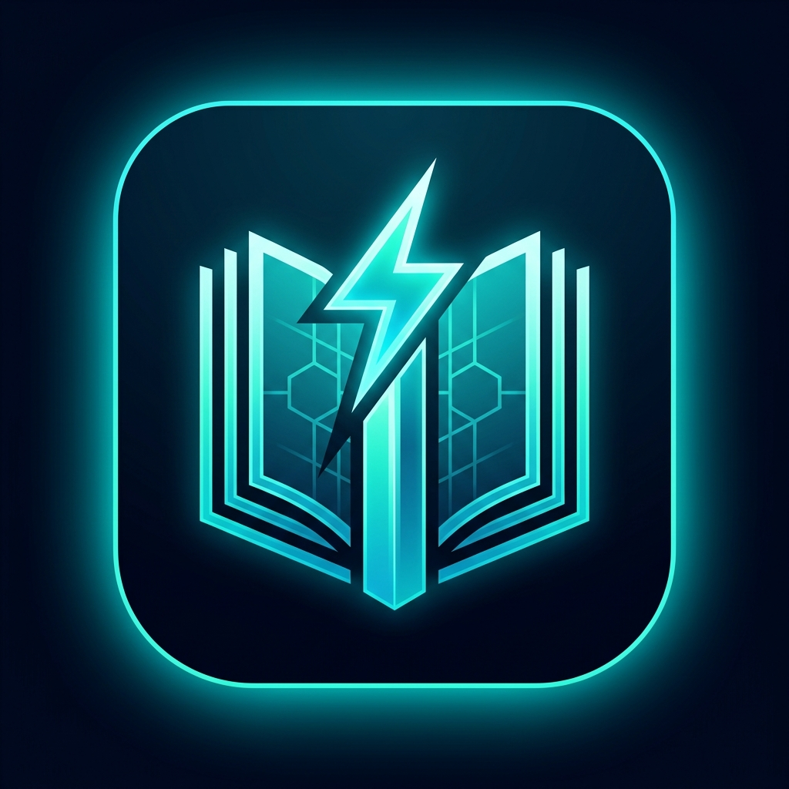

<p align="center">
  
</p>

<h1 align="center">⚡ NoteForge AI</h1>

<p align="center">
  <strong>Next-Gen AI Lecture Note Digitizer, Multimodal LaTeX OCR & Autonomous Course Vault</strong>
</p>

<p align="center">
  <a href="https://noteforge-tawny-two.vercel.app"></a>
  <a href="https://nextjs.org"></a>
  <a href="https://ai.google.dev"></a>
  <a href="https://tailwindcss.com"></a>
  <a href="https://github.com/efekkoc/NoteForge/blob/main/LICENSE"></a>
</p>

<p align="center">
  Created with ❤️ by <a href="https://github.com/efekkoc"><strong>Turgut Efekan Koç (@efekkoc)</strong></a> &bull; Part of the <strong>AquaForge Ecosystem</strong>
</p>

---

## 🌐 Live Application

Experience the live app right now without installing anything:  
🔗 **[https://noteforge-tawny-two.vercel.app](https://noteforge-tawny-two.vercel.app)**

---

## 📖 About NoteForge AI

**NoteForge AI** transforms handwritten notebook pages, whiteboard math, chalkboard equations, and lecture slides into a structured, searchable, and intelligent digital library.

Powered by Google's latest **Gemini 3.8 Flash Vision Multimodal API**, NoteForge transcribes complex formulas directly into clean $LaTeX$ formatting, generates executive summaries, predicts high-probability exam questions, and automatically routes notes into dedicated course categories.

---

## ✨ Key Features

- ⚡ **AquaForge Cyberpunk Design System:** Deep midnight dark background (`#070b14`), electric cyan/teal accents, responsive cards, and dynamic background loops.
- 📸 **Smart Camera & Upload Vision:** Capture notes directly via webcam/smartphone camera or drag-and-drop lecture images.
- 📐 **Math & Equation OCR:** Accurately decodes complex integrals, matrices, fractions, and formulas into rendered LaTeX / KaTeX.
- 🧠 **Smart Summaries & Exam Tips:** Instant bulleted key takeaways, core definitions, and AI-predicted exam questions for fast revision.
- 📚 **Autonomous Course Hub:** Auto-detects course subjects or allows manual categorization with color-coded badges, favorites tagging, and instant search.
- 🌍 **Trilingual Localization:** 1-click instant language toggle for **Türkçe (TR)**, **English (EN)**, and **Español (ES)**, including localized AI prompt analysis.
- 📱 **iPhone PWA & Apple Shortcuts Ready:** Install directly to your iOS Home Screen with standalone display mode, or invoke via iOS Shortcuts.
- 🔒 **Privacy-First & Zero Server Database Cost:** All courses, notes, and API keys are stored securely in the user's browser `localStorage`. No cloud tracking or private data leaks.
- 📤 **Developer & Student Friendly Exports:** 1-click Markdown (`.md`) download, raw clipboard copying, and side-by-side original image inspection.

---

## 📱 Mobile & iPhone Integration

### 1. Progressive Web App (Add to Home Screen)
1. Open **[https://noteforge-tawny-two.vercel.app](https://noteforge-tawny-two.vercel.app)** in **Safari** on your iPhone.
2. Tap the **Share icon ⎋** at the bottom.
3. Select **"Add to Home Screen"**.
4. NoteForge AI will be installed with its custom neon icon and will launch full-screen like a native iOS app.

### 2. Apple Shortcuts (iOS Kestirmeler)
You can automate photo capture directly from your lock screen using the iOS Shortcuts app:
- **Action 1:** `Take Photo`
- **Action 2:** `Base64 Encode`
- **Action 3:** `Get Contents of URL` (`POST` to `https://noteforge-tawny-two.vercel.app/api/analyze`)
- **Action 4:** `Show Notification` with the generated summary and formulas.

---

## 🛠️ Tech Stack

| Layer | Technology |
|---|---|
| **Framework** | [Next.js 16](https://nextjs.org/) (App Router, Webpack) |
| **Language** | [TypeScript](https://www.typescriptlang.org/) |
| **Styling** | [Tailwind CSS v4](https://tailwindcss.com/) with PostCSS & AquaForge Theme |
| **AI Model** | [Google Gemini 3.8 Flash](https://ai.google.dev/) via `@google/genai` |
| **Icons** | [Lucide React](https://lucide.dev/) |
| **Hosting** | [Vercel](https://vercel.com/) (Edge-ready, 24/7 global uptime) |
| **Storage** | Client-side `localStorage` (Privacy-first) |

---

## 🚀 Local Development Setup

If you want to run or contribute to the project locally:

```bash
# 1. Clone the repository
git clone https://github.com/efekkoc/NoteForge.git
cd NoteForge

# 2. Install dependencies
npm install

# 3. Configure environment variables (optional)
cp .env.example .env.local
# Add your Google Gemini API key:
# GEMINI_API_KEY="your_api_key_here"

# 4. Start the development server
npm run dev
```

Open [http://localhost:3000](http://localhost:3000) in your browser.

---

## 🔑 Gemini API Key

NoteForge AI uses Google's free Gemini API.
- You can obtain a free key in seconds at **[Google AI Studio](https://aistudio.google.com/app/apikey)**.
- Paste your key directly in the app via the **Settings (Key Icon)** modal, or configure `GEMINI_API_KEY` in Vercel Environment Variables to provide seamless access for all visitors.

---

## 👤 Author

**Turgut Efekan Koç**
- GitHub: [@efekkoc](https://github.com/efekkoc)
- Ecosystem: **AquaForge / Forge Studios**

---

## 📄 License

This project is licensed under the [MIT License](LICENSE).
